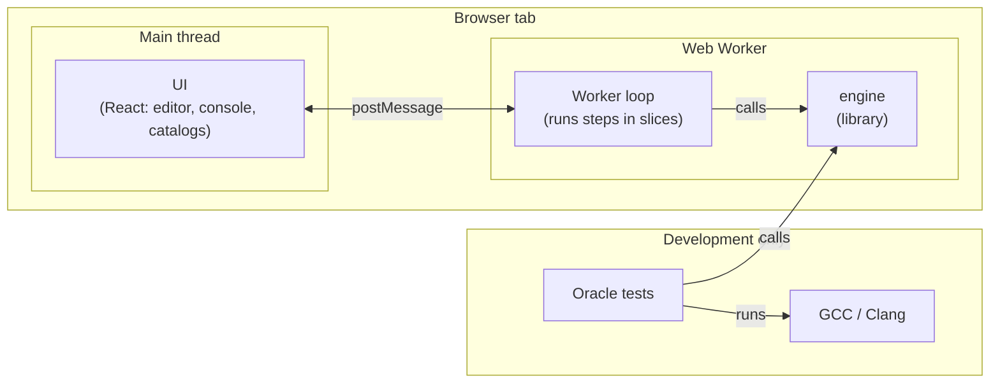

# Architecture

> Part of the [playground-cc spec](README.md). Related: [engine](engine.md), [worker protocol](worker-protocol.md), [frontend](frontend.md), [deployment](deployment.md), [docs site](docs-site.md).

## Components

| Component | Runs in | Owns | Never |
|---|---|---|---|
| `engine` | Wherever it is imported: the Worker, and Node in the tests | Turning C source into a run: preprocessing, parsing, checking, execution, the C standard library subset. Diagnostics as codes with arguments, never as text | Imports DOM, React or Worker APIs; reads the clock, randomness or any platform API. Its only inputs are the source files and the `stdin` text it is given; its outputs are program output, diagnostics and the paused state |
| Worker loop | The Web Worker | Driving the engine: starting a run, running it in slices of steps, forwarding output, asking for `stdin`, stopping. Its messages are in [worker protocol](worker-protocol.md) | Renders anything or translates text |
| UI | The main thread | The editor, the console, everything the user sees. Translates diagnostic codes with the message catalogs (`es`, `en`). The only component that touches browser storage | Runs the engine on the main thread |

- **Slices**: the Worker loop runs the engine for a slice of steps (also before the run: preprocessing, parsing and checking, [engine](engine.md#before-the-run)), then yields so incoming messages (Stop, `stdin` text) are handled before the next slice. It yields by posting the next slice to itself on a `MessageChannel`, never with a nested `setTimeout`, which browsers delay by at least 4 ms. Program output is sent to the UI once per slice, not once per write, and whenever the run pauses or ends, so the output written before a diagnostic or a Stop always reaches the console. The slice size is in [limits](limits.md).
- **One Worker per tab**: created when the page loads and reused across runs. Stop ends the run between two steps ([engine](engine.md#execution-model)). If the Worker does not confirm the Stop within a timeout ([limits](limits.md)), the UI terminates it; a new one is created on the next run, debug session or memory view session ([worker protocol](worker-protocol.md#worker-to-ui)).
- **Engine failures**: an exception thrown inside the engine is a bug in the engine. The Worker loop catches it, logs it to the console and ends the run with `engine.internal` ([errors](errors.md)); the Worker stays usable for the next run.
- **Oracle tests** run the same C programs through `engine` in Node and through GCC and Clang built natively, and compare the outputs ([testing](testing.md#oracle-tests)). They exist only in development and CI; nothing of them ships ([licensing](licensing.md)).

## Repository layout

A pnpm workspace with three packages.

| Path | Kind | Responsibility |
|---|---|---|
| `engine/` | lib | The C engine. The build enforces its independence: its TypeScript config includes no DOM or Worker types, so `window`, `document` or `postMessage` do not compile; and its `package.json` declares no UI dependency, which pnpm (no hoisting) turns into an unresolvable import of React or `web/`. Dependencies go one way: `web/` imports `engine/`, never the reverse. Unit, oracle and engine tests live here |
| `web/` | SPA | Vite + React app: the UI, the Worker entry that runs the Worker loop over `engine`, the message catalogs, and the unit and end-to-end tests. Its build is the static site ([deployment](deployment.md)) |
| `docs/` | site | The Starlight docs site, which documents the released playground ([docs site](docs-site.md)). It imports nothing from `engine/` or `web/`, and they import nothing from it |
| `design/` | docs | This spec |
